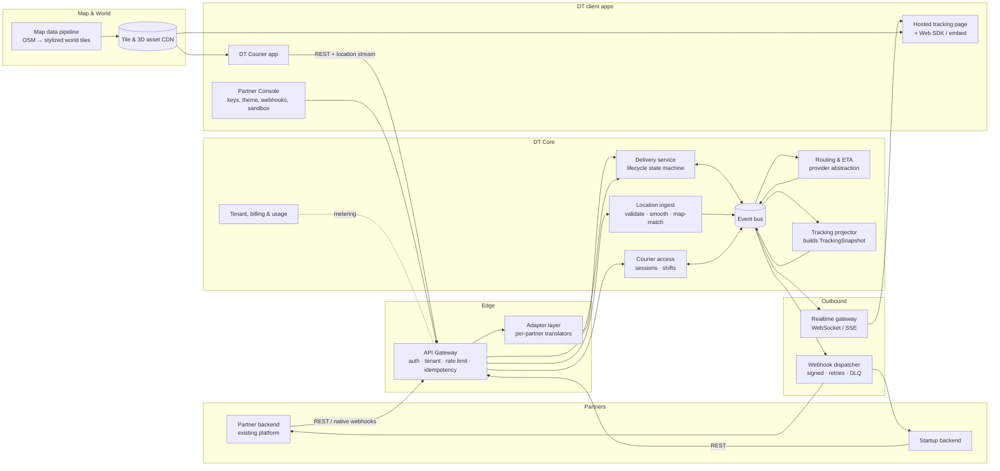
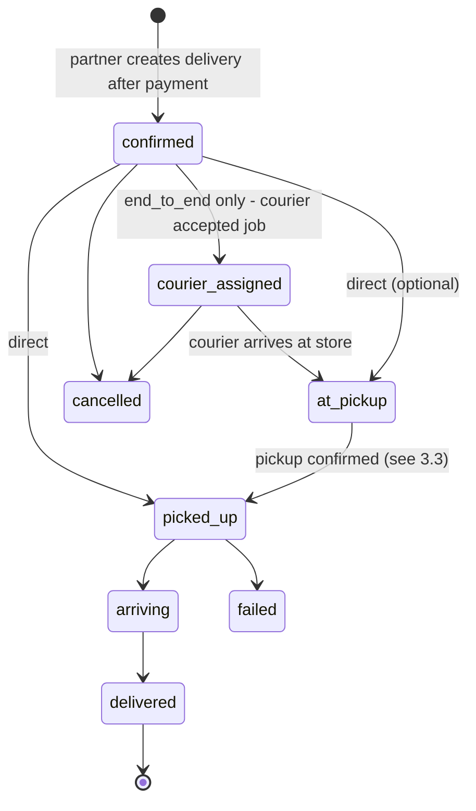
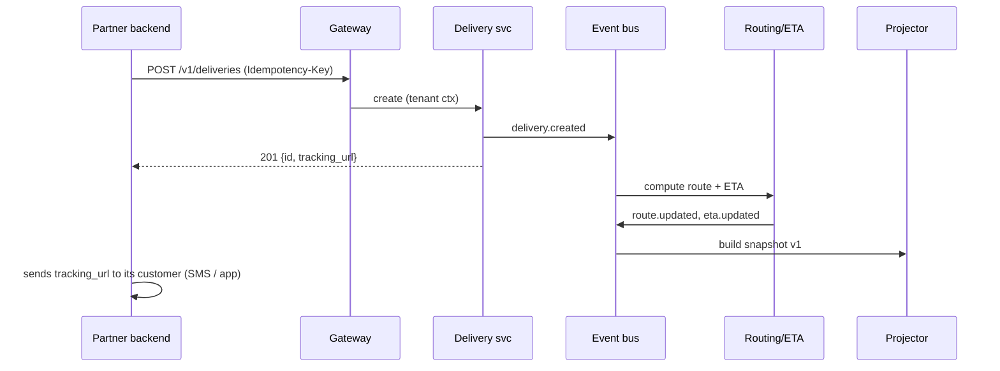
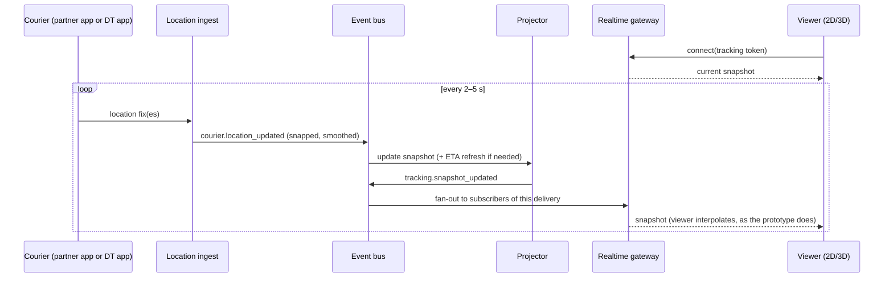
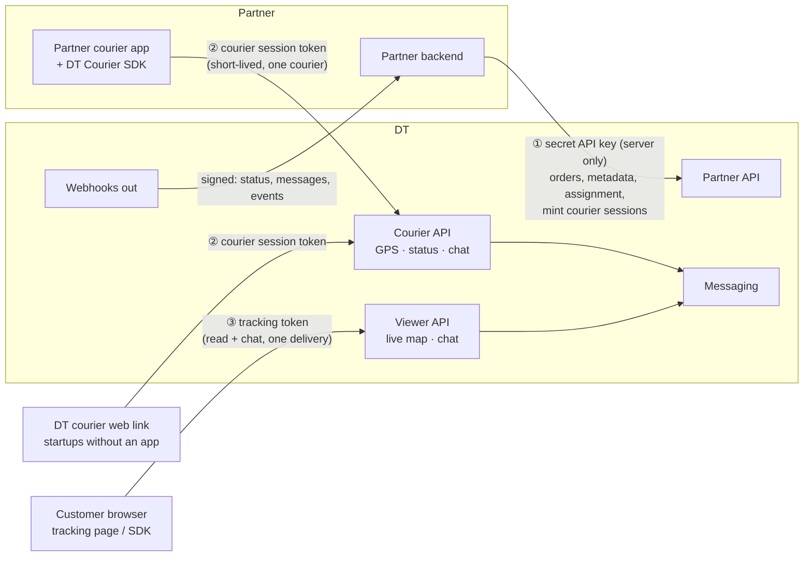

# DT: System Architecture (DRAFT v0.1)

> **Status:** draft for review. This is stack-agnostic on purpose: technology choices come in the next phase (stack brainstorming).
> **Last updated:** 2026-10-18 (added §12 courier integration, trust & messaging) · Companion file: [`PROJECT_CONTEXT.md`](PROJECT_CONTEXT.md) (vision, decisions, open questions)
> Labels: **[D#]** = decided (see PROJECT_CONTEXT), **[P#]** = proposed in this draft and waiting for approval.

---

## 1. Goals and constraints

| Goal | What it means for the architecture |
|---|---|
| Videogame-like 2D/3D tracking on **real map locations** | A map/world data pipeline that turns real geo data (streets, buildings) into a *stylized* scene and keeps the current look. |
| Two kinds of customers | **(a) existing delivery platforms** that only want the tracking UI, and **(b) startups** that need more (courier tools such as the courier web link). Both run on one core. |
| Strong, subscribable API | Public versioned REST + realtime events, per-tenant keys, sandbox, docs, usage metering. |
| Translation/integration layer | Partners send their own formats, and adapters normalize them into DT's canonical model **[D3]**. |
| Build our own solution first | DT's own apps (tracking page, courier app, console) are the first consumers of the same public API ("dogfooding"). |
| Don't block Stage 3 (marketplace) | Bounded contexts are separated now, so stores/catalog/consumers/payments can be added later without a rewrite. |
| EU first (NL) | GDPR: minimize PII, set retention limits on location history, keep data residency in the EU. |
| **Security first** (D15) | Secure by default, threat model per service, security checks in CI, pen test before launch. |
| Partners must trust us with location and order data | Separate credentials per channel (partner backend / courier device / customer), GDPR processor model, data minimization, auditability (see §12). |

**Non-goals for Stage 1:** payments, catalog/marketplace, full dispatch optimization, native mobile SDKs.

---

## 2. The big picture



**In one sentence:** partners (or our courier app) push **events** in. The core normalizes them, enriches them (route, ETA, snapped position) and projects them into a **`TrackingSnapshot`**. That snapshot is pushed out to the 2D/3D viewers over realtime channels and to partners over webhooks. The viewer draws it on top of **stylized world tiles** generated from real map data.

---

## 3. Delivery models, lifecycle and courier tooling

**Owner decision D15 (2026-10-18).** A partner picks a **delivery model** when it signs up (it's part of the plan). Separately, its couriers use either their own app or DT's courier tools. These are two independent settings.

### 3.1 Delivery models (two plans)

| | **Direct plan:** "own fleet" (e.g. Flink, dark stores, a restaurant with its own riders) | **End-to-end plan:** "independent couriers" (e.g. Uber Eats / Deliveroo style) |
|---|---|---|
| How couriers get orders | The partner's own couriers are given the order at the partner's store. No courier "goes to pick it up" from the customer's point of view. | Independent couriers **accept** a job in the partner's courier app, ride to the store or restaurant, pick up, then deliver. |
| Who dispatches | The partner (DT does not dispatch) | The partner's app (DT does not dispatch); DT is told who accepted |
| What the partner sends | Delivery data + pickup confirmation + courier GPS from pickup onward | Delivery data + **courier accepted** + arrival at store + pickup confirmation + courier GPS from acceptance onward |
| What the customer sees | "Order confirmed / being prepared" → **live map from pickup** (courier with the order) → delivered | "Order confirmed" → **live map from courier acceptance** (courier riding to the store) → pickup → delivered |
| Route shown | Store → customer | Courier → store, then store → customer (the two legs in the prototype) |

**Setting:** `delivery_model` = `direct` | `end_to_end`. It is set per tenant from the plan and can be **overridden per delivery** (confirmed, D16), because a partner with its own fleet may sometimes hand overflow orders to independent couriers.

### 3.2 Delivery lifecycle per model



- **Payment rule:** the partner creates a delivery in DT **only after the customer's payment is confirmed**. The tracking link exists from that moment. Until the courier becomes visible, it shows the **3D map with the store and the customer's home, the store animated as "preparing", and the ETA** (D16).
- **Delivery session:** the live part of tracking starts with the **pickup confirmation** in both models. In `end_to_end` the customer also sees the pickup leg, from `courier_assigned` onward.
- **Courier visibility (answers OQ4b):** the customer sees the courier's live position **only after payment is confirmed AND a courier is in charge**. In `direct` that means from `picked_up`; in `end_to_end` it means from `courier_assigned`. It is hidden immediately after `delivered`, `cancelled` or `failed`.

### 3.3 Pickup handover: multi-party confirmation (answers OQ4d)

The handover from store to courier can be confirmed by several parties, and **each confirmation is broadcast to everyone involved**:

| Who confirms | How it reaches DT |
|---|---|
| **Courier** ("I have the order") | Courier device → DT directly (channel ②, courier session token) |
| **Store** (e.g. McDonald's marks "handed to courier") | Store system → partner backend → DT (channel ①), recorded as `confirmed_by: store` |
| **Partner** (its own logic) | Partner backend → DT (channel ①) |

- **Policy per tenant:** `pickup_confirmation` = `any` (default, confirmed D16: the first confirmation wins) | `courier` | `store` | `courier_and_store` (both are needed before `picked_up`).
- Every confirmation is stored as `delivery.pickup_confirmed { by, at }`. When the policy is satisfied, the status moves to `picked_up` and DT **broadcasts** the change: a webhook to the partner (so the partner app and store see it), a realtime update to the customer's map, and an update to the courier's device.
- **The same broadcast pattern applies to courier acceptance** in `end_to_end`. The partner app (or the courier device) reports `courier.assigned`, and DT shows the customer that a courier is on the way to pick up the order, as Uber Eats does.

### 3.4 Courier tooling (independent of the plan)

| Option | For whom | How GPS and status reach DT |
|---|---|---|
| **Partner's own courier app + DT Courier SDK** | Partners who already have a courier app | Phone → DT directly (decided default, D15) |
| **DT courier web link** | Startups without a courier app | Phone browser → DT directly |
| **Backend relay** (fallback) | Partners who won't allow devices to talk to a third party | Partner backend → DT |

The `source` field on each event records which path was used, so the core is the same for all of them.

---

## 4. Components (bounded contexts)

Each unit has one purpose, a clear interface and its own data. They can start inside **one deployable** (see §9).

### 4.1 Edge
- **API Gateway:** resolves the tenant from the API key (or from OAuth2 client-credentials later), checks scopes, applies rate limits per plan, enforces `Idempotency-Key` on writes, records usage, tags requests with request IDs.
- **Public API v1:** resource-oriented REST. Main resources: `deliveries`, `deliveries/{id}/events`, `couriers`, `couriers/{id}/locations` (batch), `tracking-links`, `webhook-endpoints`, `themes`. **[D6]** OpenAPI + AsyncAPI.
- **Adapter layer [D3]:** one *inbound adapter* per non-standard partner. It accepts the partner's native webhook/payload, maps it to canonical commands and emits them. Adapters are **stateless translators** with mapping config plus small code hooks, versioned and testable with recorded fixtures. Outbound adapters (when a partner needs webhooks in its own shape) work the same way in reverse.

### 4.2 Core
- **Delivery service:** owns the delivery aggregate and the **lifecycle state machine** (`confirmed → courier_assigned → at_pickup → picked_up → arriving → delivered`, plus `cancelled` and `failed`; the path depends on the delivery model, §3.2). It validates transitions, tolerates events that arrive out of order or twice (idempotent by `event_id`), and emits canonical domain events.
- **Location ingest:** the high-volume path (pings every 2–5 s). It validates fixes (accuracy, impossible jumps), deduplicates, **map-matches** (snaps to roads) and smooths, then emits `courier.location_updated`. It doesn't write every ping to the relational DB.
- **Routing & ETA:** a provider abstraction (`RouteProvider` interface), so the engine behind it can be swapped later. It recomputes the route and ETA when the courier deviates or the status changes, and caches routes.
- **Tracking projector:** consumes events and keeps the **`TrackingSnapshot` read model** (the contract that already exists in `src/engine/types.ts`, versioned). Hot snapshots live in a fast cache, and changes are published to `tracking.snapshot_updated`.
- **Courier access:** courier session tokens, scopes and shift/delivery state for couriers whose phones send data directly to DT (§12). **DT does not dispatch.** The partner (or its courier app) decides which courier takes a job and tells DT (`courier.assigned`). Dispatch-lite stays a possible later add-on.
- **Tenant, billing & usage:** tenants, environments (`sandbox` / `live`), API keys (hashed, scoped, rotatable), plans and quotas, usage metering (deliveries tracked, active viewers, location pings). The billing provider is plugged in later.

### 4.3 Outbound
- **Realtime gateway:** viewers connect with a **tracking token** (short-lived and limited to one delivery). It fans out snapshot updates over WebSocket and falls back to SSE or polling. It scales horizontally because its only state is subscriptions.
- **Webhook dispatcher:** sends status changes to partner endpoints. Payloads are HMAC-signed, retried with exponential backoff, failures go to a dead-letter queue, and partners can replay from the console.

### 4.4 Map & World (the "real maps + our style" part; decided D17: own renderer on OpenStreetMap vector data)
- **Map data pipeline:** ingests open map data (roads, building footprints with heights, land use, water, parks, POIs) and produces **world tiles** that are optimized for our stylized renderer (simplified geometry plus semantic tags such as `building:residential`, `road:primary`, `park`).
- **Tile & asset CDN:** world tiles plus 3D asset packs (bike, scooter, car, store, house, trees) and tenant theme packs.
- **World renderer (client):** evolves the current `CityScene`. It loads the tiles around the delivery, builds low-poly meshes in DT style, places the courier, store and destination from snapshot coordinates, and switches between **2D (top-down/flat)** and **3D (isometric/orbit)**.

### 4.5 Client apps
- **Tracking Renderer core (shared package):** the contract types, `TrackingSource` implementations (simulator, WebSocket, SSE), interpolation, the world renderer and theming. Everything else builds on this.
- **Hosted tracking page:** `track.<domain>/{token}`, branded per tenant. It's the fastest integration (link, iframe, mobile webview).
- **Web SDK / embed:** the same core shipped as a JS package or web component with a theme config, for partners who want it inside their own app.
- **DT Courier app (Mode F):** sign in, go online/offline, receive offers, navigate to pickup and drop-off, update status, stream location (including in the background).
- **Partner Console:** API keys, webhooks, theme editor with live preview, **sandbox simulator** (the current prototype simulator becomes a feature that lets partners test without real couriers), request and event logs, usage.
- **Internal admin:** tenant management, support tools, adapter management.

---

## 5. Canonical event model

**[P2]** Every input becomes a canonical event with an envelope like this:

```json
{
  "event_id": "evt_01J...",          // unique, used for idempotency
  "type": "delivery.status_changed",  // or courier.location_reported, delivery.created...
  "schema_version": 1,
  "tenant_id": "ten_...",
  "environment": "live",
  "occurred_at": "2026-10-18T12:00:03.120Z",  // when it happened (source clock)
  "received_at": "2026-10-18T12:00:03.410Z",  // when DT got it
  "source": "partner_api | adapter:<name> | dt_courier_app | simulator",
  "subject": { "delivery_id": "del_...", "courier_id": "cou_..." },
  "data": { }
}
```

Main event types: `delivery.created`, `delivery.status_changed`, `delivery.updated` (address/ETA from partner), `delivery.cancelled`, `courier.assigned`, `delivery.pickup_confirmed` (with `by: courier | store | partner`), `courier.location_reported` (raw), `courier.location_updated` (processed), `route.updated`, `eta.updated`, `tracking.snapshot_updated`.

Rules: ordering is by `occurred_at` per delivery, and stale location pings are dropped. Changes are additive only within a major version.

---

## 6. Main data flows

### 6.1 Delivery created → tracking link


### 6.2 Live tracking loop (hot path)


### 6.3 Status change → partner webhook
Delivery service emits `delivery.status_changed` → the webhook dispatcher looks up the tenant's endpoints → signs and sends → retries on failure → after N attempts the event goes to the DLQ and is visible and replayable in the console.

---

## 7. Data storage (by access pattern, not by product)

| Data | Pattern | Store type |
|---|---|---|
| Tenants, keys, deliveries, couriers, webhooks config | Transactional, relational | Relational DB with geo support |
| Domain events | Append-only, replayable | Event bus with retention + **outbox table** for reliable publishing |
| Live snapshots, courier last position, subscriptions | Very hot, short-lived | In-memory cache / KV with TTL |
| Location history | High-volume, time-ordered, retention 30–90 days | Time-series / partitioned table |
| World tiles, 3D assets, themes | Static, global | Object storage + CDN |
| Usage counters | Aggregated per tenant/period | Relational (rolled up from events) |

---

## 8. Cross-cutting concerns

- **Multi-tenancy:** `tenant_id` + `environment` on every row and every event. Isolation is enforced at the data-access layer (e.g. row-level security). Sandbox and live keys are separate.
- **Security:** API keys are stored hashed with scopes. Tracking tokens are signed, expire, and are bound to one delivery with read-only access. Webhooks are HMAC-signed. TLS everywhere. Tracking links never expose the end customer's personal data: show only an approximate address and the courier's first name.
- **Privacy (GDPR):** courier location is only collected while on shift/delivering. Retention on location history is configurable per tenant. There's a DPA for partners, and data stays in the EU.
- **Reliability:** idempotent writes, the outbox pattern, at-least-once events with idempotent consumers, and graceful degradation (if the realtime channel drops, the viewer falls back to polling; if routing fails, show the last known route plus a straight-line ETA).
- **Observability:** request/event tracing with `request_id`/`event_id`, a per-tenant log viewer in the console, and SLOs on ingest-to-viewer latency (target **< 1 s p95**).
- **API lifecycle:** `/v1` with additive changes, deprecation headers, a changelog, sandbox parity with live.
- **Scale assumptions (to validate):** start ~1k active couriers → 200–500 pings/s; design for 10k+ couriers (~5k pings/s) and 100k concurrent viewers by scaling the ingest and realtime gateways horizontally.

---

## 9. Deployment shape: approaches

> **Owner decision 2026-10-18 (D13):** the backend is **modular, not a monolith**. It is split by bounded context, and each service follows **onion architecture** (domain → application → adapters/infrastructure, dependencies point inward). Contracts between services are versioned. This replaces the recommendation below. **Day-one services (D17):** gateway, deliveries, tracking, webhooks, accounts-billing; messaging later.

**[P3]** Three options:

1. **Modular monolith + two scalable edge workers** *(recommended)*. One core deployable with strict module boundaries (§4). **Location ingest** and the **realtime gateway** run as separate horizontally scaled processes, because they're the hot path. Benefits: fast to build with a small team, one DB, easy refactoring while the model is still being learned **[D3]**, and modules can be split into services later along the existing boundaries.
2. **Microservices from day one.** Independent scaling and deploys, but a lot of ops overhead (service mesh, distributed tracing, many pipelines) before we have product-market fit. Too early.
3. **BaaS/serverless-first** (realtime DB + functions). Quickest prototype, but there's vendor lock-in, a weak fit for a public partner API with metering and adapters, and expensive high-frequency pings at scale.

---

## 10. Repository / code layout (proposed, stack-agnostic)

```
dt/
  apps/
    api/              core modular monolith (gateway, delivery, courier, tenant, projector, webhooks, adapters)
    ingest/           location ingest worker
    realtime/         realtime gateway
    tracking-web/     hosted tracking page
    console/          partner console
    courier-app/      DT courier app
    map-pipeline/     world tile builder (batch)
  packages/
    contract/         TrackingSnapshot + event schemas (single source of truth, generates OpenAPI/AsyncAPI types)
    renderer/         world renderer + TrackingSource impls (evolved from current src/view + src/engine)
    sdk-js/           partner-facing web SDK / embed
    simulator/        current prototype simulator, reused for sandbox + demos
  docs/
```

The current prototype maps cleanly onto this: `src/engine/types.ts` → `packages/contract`, `src/view/*` → `packages/renderer`, `src/engine/simulator.ts` → `packages/simulator`.

---

## 11. How later stages plug in

- **Stage 2 (B2B go-to-market):** console self-serve signup, plans and billing, theme editor, docs portal. These are already contexts in §4.
- **Stage 3 (marketplace / "multiverse"):** new contexts **Store & Catalog** (claimable business listings linked to POIs in the Map & World pipeline), **Consumer accounts**, **Ordering & Payments**. They become *producers* of `delivery.created`, so the tracking core doesn't change.

---

## 12. Courier integration, trust & messaging (owner decision D14, 2026-10-18)

**Owner direction:** the courier shares live GPS with DT. Most of DT's integration happens **with the courier side**. Partners hand location and order data to a third party (us), so DT must earn and prove trust through strong authentication and data protection. Customers and couriers can also **talk to each other through DT**, and DT passes those messages to the partner's side as well.

### 12.1 The three integration channels

Each channel has **its own credential**. A credential never leaves the place it belongs to.



| Channel | Who | Credential | Can do | Can never do |
|---|---|---|---|---|
| **① Partner ↔ DT** | Partner backend (server-to-server) | **Secret API key** (`sk_live_…` / `sk_test_…`), optionally OAuth2 client-credentials later | Create/update deliveries + metadata, assign couriers, **mint courier session tokens**, read everything for its tenant, manage webhooks | Be used from a browser or phone (its use is detected and blocked by origin checks + docs) |
| **② Courier ↔ DT** *(primary live data path)* | Partner's courier app (with the DT Courier SDK), or the DT courier web link | **Courier session token**: minted by the partner backend through ①, valid for one courier on one shift (e.g. ≤ 12 h, refreshable), scopes `location:write status:write messages:rw` | Stream GPS, report status taps (`at_pickup`, `picked_up`, `delivered`), chat with the customer of **its assigned deliveries only** | Read other couriers or deliveries, create orders, see the customer's personal data beyond what the delivery needs |
| **③ Customer ↔ DT** | End customer's browser (hosted page or SDK) | **Tracking token**: one delivery, read-only + chat, expires shortly after delivery | Watch the live map, see ETA/status, chat with the courier | See courier's exact location outside the allowed window (§12.4), see any other delivery |

**Courier GPS path (decided, D15):** the courier's **phone sends directly to DT** using its courier session token. This is the default because it has the lowest latency and the partner needs no servers to relay high-frequency pings. Backend relay through the partner's server stays available as a fallback. Both feed the same pipeline, and the `source` field records which path was used.

**Who can report status (decided, D15):** the partner backend, the courier device and the store (through the partner backend) can all report status. Pickup uses multi-party confirmation with a per-tenant policy (§3.3). The state machine rejects impossible transitions, and every accepted change is broadcast to all parties.

### 12.2 Authentication & API security (how partners can trust us)

> **Security is the first priority (owner decision D15).** Secure by default, least privilege everywhere. A threat model is written before each service is built. Security checks run in CI (dependency and secret scanning, static analysis, authz tests). Nothing ships without authentication, authorization tests and audit logging. An independent pen test happens before launch.


- **API keys:** stored only as hashes. They are shown once, scoped, kept separate for test and live, can be rotated with an overlap window, can be revoked instantly, and are optionally restricted by IP allowlist. Every use is logged in an audit log the partner can see.
- **Tokens:** courier session tokens and tracking tokens are signed (asymmetric keys, rotated, `kid` header), short-lived, bound to a tenant and subject, and revocable through a deny-list checked on the hot path.
- **Transport:** TLS 1.2+ everywhere, HSTS, and certificate pinning available in the native SDKs later. Request signing (HMAC) and mTLS are available as enterprise options.
- **Webhooks out:** each one carries an HMAC-SHA256 signature over `timestamp.body`. Timestamps outside a 5-minute window are rejected (replay protection). Endpoints must be HTTPS and verified once, and secrets can be rotated.
- **Abuse protection:** rate limits per key, per courier and per token. Implausible GPS (teleporting, impossible speeds) is flagged, and payload sizes are capped.
- **Idempotency** on every write (`Idempotency-Key`), so retries never duplicate orders or messages.

### 12.3 Data protection (GDPR) and order metadata

- **Roles:** the partner is the **data controller** and DT is the **processor**. We provide a Data Processing Agreement, a public list of sub-processors, and EU-only hosting and storage.
- **Data minimization by design:**
  - The **customer** is a delivery address as coordinates, plus an optional first name and an optional drop-off note. **No phone numbers or emails are needed**, because messaging runs inside DT.
  - The **courier** is a display name, an optional photo and a vehicle type.
  - **Order metadata** has two parts. One is structured fields: `items_summary`, `item_count`, `pickup_name`, `notes`. The other is a free `metadata` key/value object (e.g. ≤ 50 keys, ≤ 500 chars per value) that is returned to the partner and **never shown publicly**. Payment data is forbidden, and the docs say so explicitly.
- **Encryption:** at rest (database, backups, object storage) and in transit. Sensitive fields such as notes and messages get extra field-level encryption.
- **Retention:** raw GPS is kept 30 days by default (configurable). After that only a simplified route is kept for the delivery record. Messages are kept 30 days after delivery by default. Retention is configurable per tenant.
- **Partner control:** a deletion API (`DELETE /v1/deliveries/{id}/personal-data`), data export, and an audit log of who accessed what.
- **Trust signals for partners:** a public Security & Privacy page in the docs, a status page, and a responsible-disclosure policy. An independent pen test happens before launch, and SOC 2 / ISO 27001 are on the roadmap.

### 12.4 Courier privacy (location only when it's needed)

- GPS is collected **only while the courier has an active delivery**, which is purpose limitation. The SDK stops collecting when the delivery ends or the shift ends.
- **Visibility to the customer follows the delivery model (§3.2):** only after payment is confirmed AND a courier is in charge (`direct`: from pickup; `end_to_end`: from courier acceptance). It is hidden immediately after delivery, cancellation or failure.
- The courier's identity shown to customers is limited to first name, optional photo and vehicle.

### 12.5 Messaging (customer ↔ courier through DT): **designed, NOT in the MVP** (owner, 2026-10-18)

> Kept in the architecture so it can be added later without redesign. The MVP has no chat.

A new bounded context called **Messaging**:
- **Conversations** belong to one delivery and have up to three participants: customer, courier and partner support (optional).
- **Customer side:** a chat panel in the tracking page or SDK, which also carries system messages ("Your courier is arriving").
- **Courier side:**
  - The DT Courier SDK or courier web link shows the chat directly, **or**
  - for partners with their own courier app UI, DT sends `message.created` webhooks to the partner and the partner posts courier replies via `POST /v1/deliveries/{id}/messages` (channel ①) or the SDK (channel ②).
- **"Communication to their end":** every message, and every system notification, is also delivered to the partner via webhook. That way their support team and records stay complete, and their app can show messages in its own UI.
- **Quick replies** cover the common cases ("I'm at the door", "Leave at the door", "Can't find the address"), which is faster for couriers and works across languages.
- **Safety:** messages are text only in the MVP, and links are stripped or neutralized. Customers can report a message, rate limits apply, and the chat closes N minutes after delivery.
- **Later:** masked phone calls (a proxy number), photo proof of delivery, push notifications through partner apps.

### 12.6 Impact on the rest of the architecture

- **New bounded contexts:** **Courier Access** (courier sessions, scopes, shift state) and **Messaging** (post-MVP). Both follow the same onion layering (D13).
- **New events:** `courier.session_started`, `courier.session_ended`, `courier.status_reported`, `message.created`, `message.read`, `conversation.closed`.
- **New client package:** the **DT Courier SDK (web/JS first)**, which handles GPS sampling, batching, offline buffering, token refresh and chat. The courier web link is a thin page built on it. Native iOS/Android SDKs come later.
- **Proposed services (OQ5b)** gain `messaging`, and courier access lives in `gateway` (identity and tokens) or as its own service.

## 13. Open architecture questions

The live list is in [`OPEN_QUESTIONS.md`](OPEN_QUESTIONS.md).
